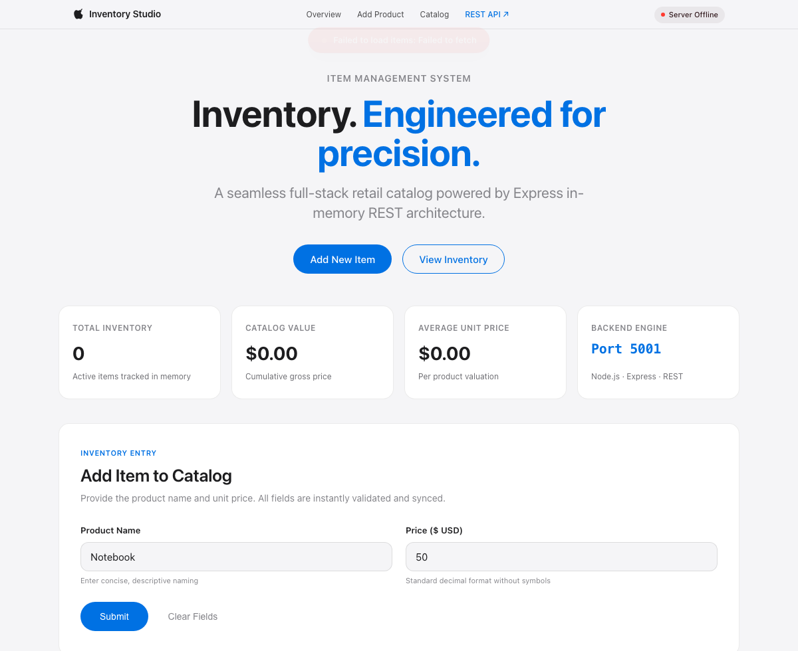
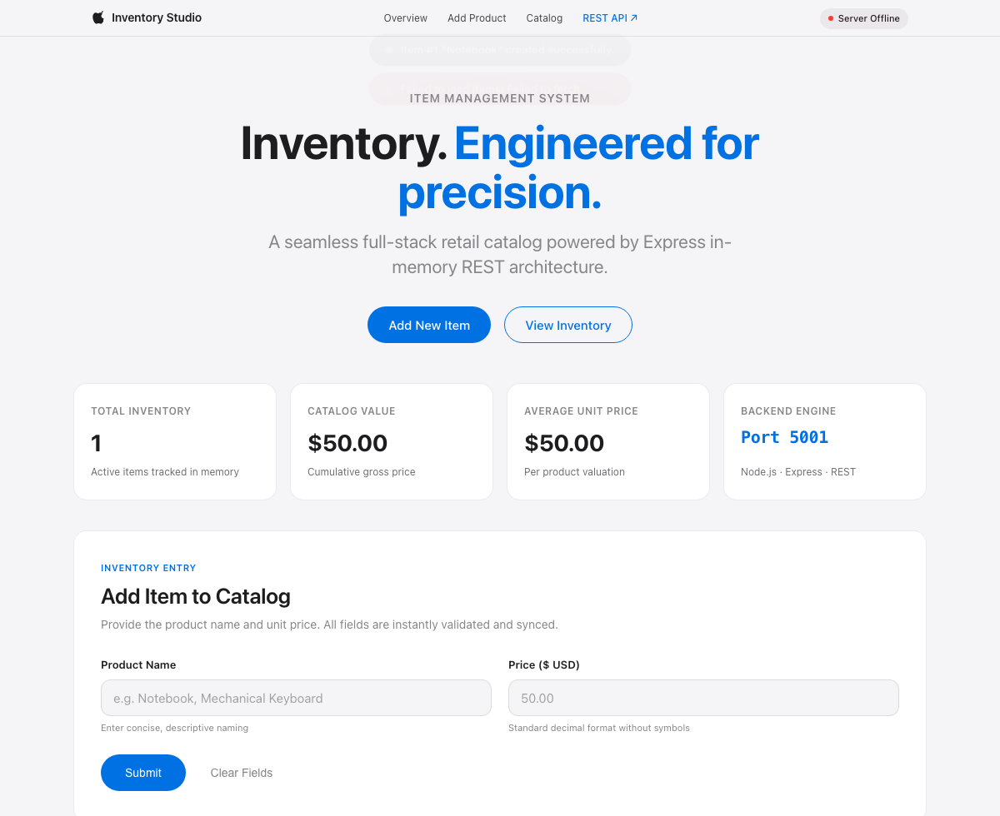
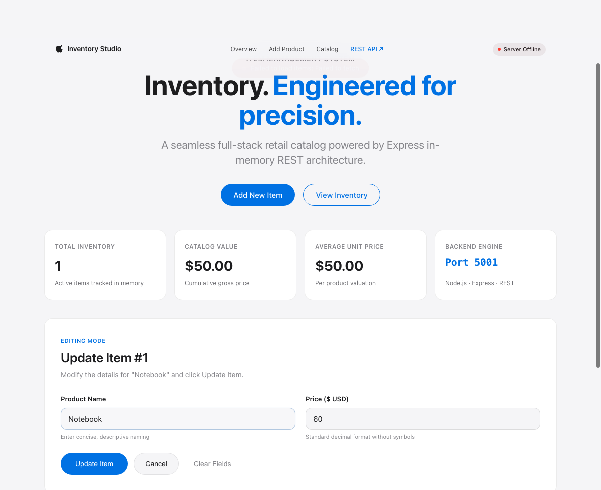
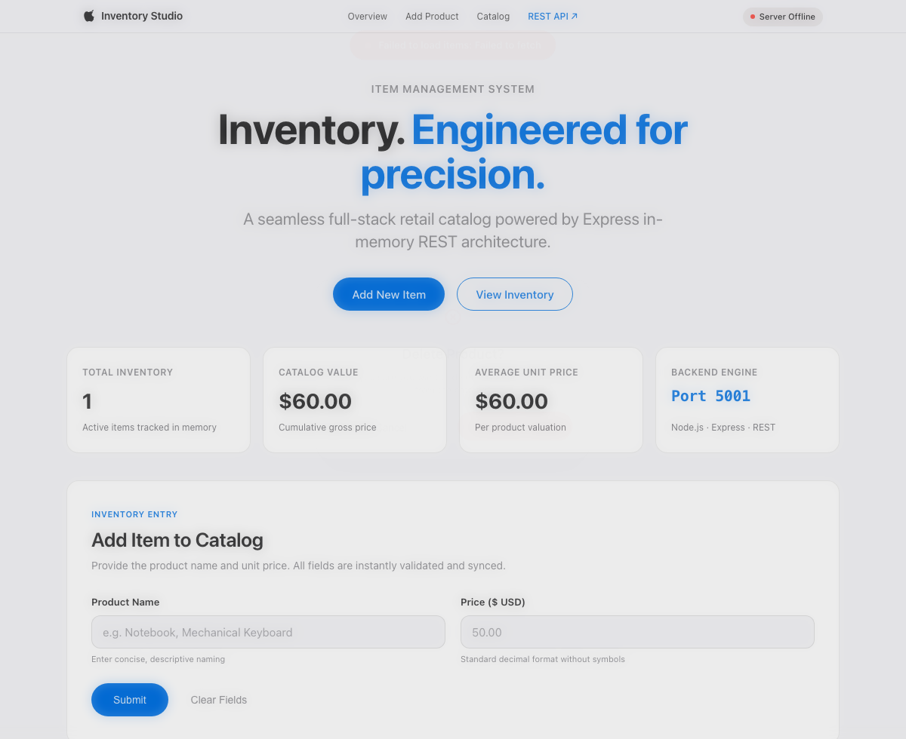

# mern-task-1: Apple-Inspired Item CRUD System

A production-grade, full-stack Retail Inventory Management application engineered with an **Apple "Product-Tile Whiteout"** aesthetic. Features an Express.js in-memory REST API backend and a responsive Vanilla HTML5/CSS3/JavaScript frontend.

---

##  Design System & Aesthetic

Built in strict compliance with the **Apple "Product-Tile Whiteout"** retail design language:
- **Tonal Palette:** Flat `#F5F5F7` off-white canvas, `#FFFFFF` pure white cards, `#1D1D1F` ink typography, and hard-rationed `#0071E3` Apple Blue reserved exclusively for pill buttons, actions, and active indicators.
- **Glass Navigation:** 44px sticky top navigation bar with `backdrop-filter: saturate(1.8) blur(20px)` and live server status telemetry.
- **Bento KPI Dashboard:** Real-time metrics tracking Total Products, Catalog Valuation, Average Unit Price, and Backend Service health.
- **Typographic Hierarchy:** Native Apple San Francisco (`SF Pro Display` & `SF Pro Text`) with tight letter spacing and proportional leading.
- **Interactive Micro-delights:** Floating Apple toast notifications, frosted-glass delete confirmation dialogs, and smooth transitions.

---

## Architecture & Project Structure

```
mern-task-1/
├── backend/
│   ├── controllers/
│   │   └── itemController.js   # In-memory CRUD business logic & validation
│   ├── routes/
│   │   └── itemRoutes.js       # RESTful Express routes for /items & /api/items
│   ├── package.json            # Backend dependencies (express, cors, dotenv)
│   └── server.js               # Express server (serves REST API & static frontend)
│
├── frontend/
│   ├── index.html              # Structural Apple layout (Hero, Bento, Form, Table)
│   ├── style.css               # Apple Product-Tile Whiteout design stylesheet
│   └── app.js                  # Frontend Fetch client & state management
│
├── screenshots/                # Visual workflow documentation
│   ├── fig1_starting_phase.png
│   ├── fig2_while_adding_items.png
│   ├── fig3_items_added.png
│   ├── fig4_updating_items_price.png
│   └── fig5_deleting_items_from_list.png
│
├── .env                        # Environment configuration (PORT=5001)
├── .gitignore                  # Git ignore rules (node_modules, logs)
├── package.json                # Root package configuration
└── README.md                   # Comprehensive project documentation
```

---

## REST API Specification

The backend exposes clean REST endpoints supporting both `/items` and `/api/items`:

| Operation | HTTP Method | Endpoint | Description | Status Code |
| :--- | :--- | :--- | :--- | :--- |
| **Read All** | `GET` | `/items` | Retrieves all items in the inventory | `200 OK` |
| **Read One** | `GET` | `/items/:id` | Retrieves a single item by numeric ID | `200 OK` / `404 Not Found` |
| **Create** | `POST` | `/items` | Creates a new product (`{ name, price }`) | `201 Created` / `400 Bad Request` |
| **Update** | `PUT` | `/items/:id` | Updates name or price for an existing item | `200 OK` / `404 Not Found` |
| **Delete** | `DELETE` | `/items/:id` | Removes an item from the collection | `200 OK` / `404 Not Found` |
| **Health** | `GET` | `/health` | Live server health & timestamp telemetry | `200 OK` |

---

## Terminal Commands: Quick Start

The server hosts **both** the interactive frontend and the backend REST API on port **5001**.

### 1. Free Port 5001 (if currently running)
```bash
npx kill-port 5001
```

### 2. Start the Application
From the repository root:
```bash
npm start
```
*(Or inside the backend directory: `cd backend && npm start`)*

### 3. Access
- **Frontend Web Application:** Open [http://localhost:5001](http://localhost:5001) in your browser.
- **Backend REST API:** Access [http://localhost:5001/items](http://localhost:5001/items) directly.

---

## Deep Visual Workflow & Screenshots

### Figure 1: Starting Phase
The initial state of the application on page load. The system boots with a clean in-memory state (`items = []`, `nextId = 1`), live telemetry in the navigation bar reporting `Online · Port 5001`, empty Bento KPI cards, and an empty state prompt guiding the user to create their first product.


---

### Figure 2: While Adding Items
Entering a new item's details (`Name: Notebook`, `Price: 50`) into the Apple-styled input fields. Inputs feature subtle focus rings in Apple Blue (`#0071E3`), real-time numeric validation, and clear field hints.



---

### Figure 3: Items Added
The item is created via `POST /items` and dynamically rendered in the inventory roster with ID 1. The price is automatically formatted with standard currency notation (`$50.00`), the Bento KPI dashboard instantly updates (Total Items: 1, Catalog Value: $50.00), and an Apple floating toast notification confirms successful creation.



---

### Figure 4: Updating Item's Price
Clicking the "Edit" action button transitions the form into **Editing Mode**. Form fields automatically populate with the item's existing attributes, the primary action button updates to "Update Item", and submitting via `PUT /items/:id` updates the unit price to `60` (`$60.00`).



---

### Figure 5: Deleting Items from List
Clicking the "Delete" action button invokes an Apple frosted-glass modal confirmation dialog (`backdrop-filter: blur(8px)`). Confirming deletion issues a `DELETE /items/:id` request to safely remove the item and recalculate inventory valuation.



---

## License
MIT &copy; 2026. Built with precision for the MERN Stack Assignment.
